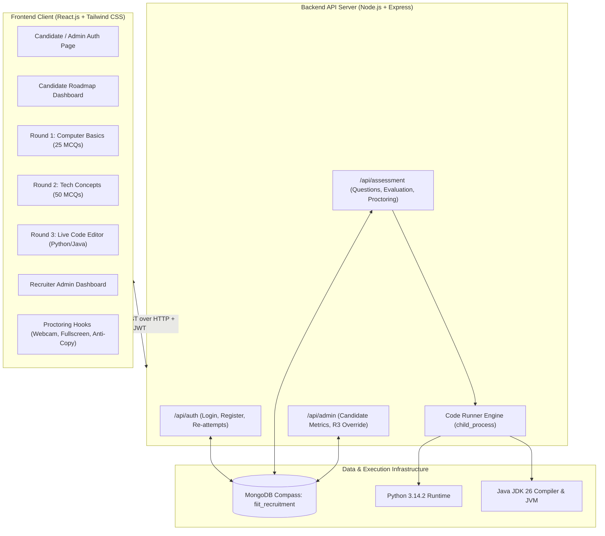
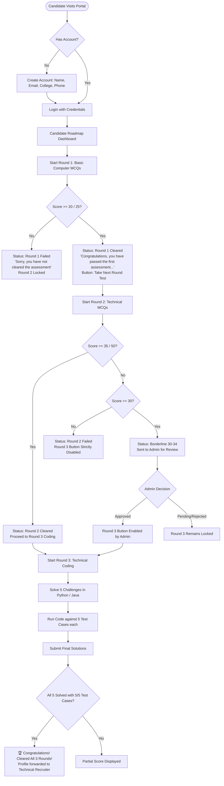
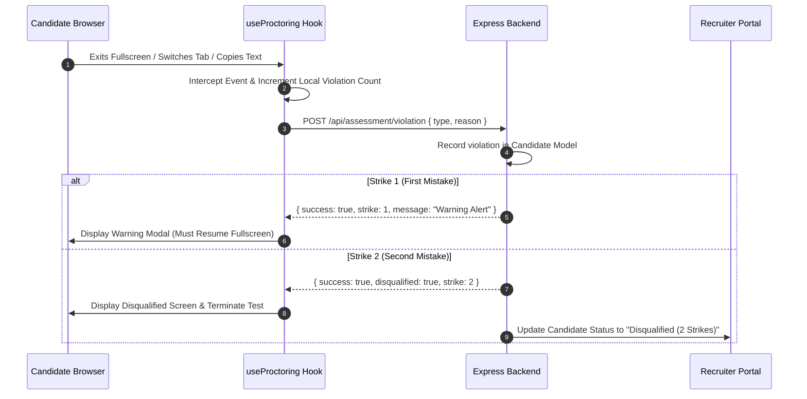

# FIIT Job Fair Assessment & Candidate Screening Web Application
## Comprehensive Project Documentation & Technical Specification Manual

---

## 1. Executive Summary

### 1.1 Project Overview
The **FIIT Job Fair Assessment & Screening Web Application** is an enterprise-grade recruitment and evaluation platform developed specifically to streamline the candidate shortlisting process during campus recruitment drives and job fairs. 

The application systematically evaluates candidates across three distinct stages:
1. **Round 1**: Basic Computer & OS Knowledge (MCQ)
2. **Round 2**: Core Technical Concepts (Java, Python, Web Technologies, SQL) (MCQ)
3. **Round 3**: Algorithmic & Problem Solving (Live in-browser coding in Python or Java with real-time test case verification)

To guarantee academic and assessment integrity, the system incorporates an integrated **AI Proctoring Engine** featuring live webcam tracking, fullscreen locking, clipboard and copy-paste prevention, screenshot interception, and a strict **2-strike violation policy**.

In addition, an **Administrative Recruiter Portal** provides real-time oversight of candidate scores, detailed attempt counters (e.g., *1st Time* vs *2nd Time* attempts), and manual approval controls for borderline candidates (scoring 30–34 in Round 2).

---

## 2. Technology Stack & Environment

| Component | Technology | Version | Purpose / Role |
| :--- | :--- | :--- | :--- |
| **Frontend Framework** | React.js (Vite) | 18.3.1 / 5.4.11 | Single Page Application (SPA), stateful routing, responsive UI |
| **UI Styling** | Tailwind CSS | 3.4.17 | Modern utility-first CSS, dark-mode styling, animations |
| **Icons & Visuals** | Lucide React | 1.16.0 | Vector UI icons for navigation, warnings, and proctoring badges |
| **Celebrations** | Canvas Confetti | 1.9.4 | Visual feedback upon clearing assessment rounds |
| **Backend Framework** | Node.js + Express | 24.12.0 / 4.21.2 | RESTful API server, routing, and controller architecture |
| **Database** | MongoDB + Mongoose | 9.0 / 8.9.5 | Document storage, schema modeling, persistent candidate history |
| **Database GUI** | MongoDB Compass | Compatible | Live database inspection at `mongodb://127.0.0.1:27017` |
| **Authentication** | JWT + Bcrypt.js | 9.0.2 / 3.0.2 | Secure stateless token-based auth & salted password hashing |
| **Code Runner** | Child Process (Node.js) | Native | Sandboxed real-time execution engine for Python 3 & Java |
| **Language Runtimes** | Python 3 & Java (JDK 26) | 3.14.2 / 26+35 | Code execution runtimes for Round 3 assessment |

---

## 3. High-Level System Architecture

The following diagram illustrates the complete architectural interaction between the candidate client, recruiter admin dashboard, backend Express server, MongoDB database, and compiler execution engines:



---

## 4. Assessment Rounds & Work Flow Rules

### 4.1 Candidate Journey Flowchart



---

### 4.2 Round Specifications Table

| Round | Focus / Subject | Questions | Passing Mark | Randomization | Outcome / Progression |
| :--- | :--- | :--- | :--- | :--- | :--- |
| **Round 1** | CPU, Memory, OS, Hardware, Networking, Fundamentals | 25 MCQs | **&ge; 20 / 25** (80%) | 25 questions sampled from 40-item bank; option order shuffled per candidate. | Pass: Unlocks Round 2 button.<br/>Fail: Round 2 locked. |
| **Round 2** | Java, Python, HTML, CSS, JavaScript, React.js, SQL | 50 MCQs | **&ge; 35 / 50** (70%) | 50 questions sampled from 75-item bank; option order shuffled per candidate. | Pass (&ge;35): Round 3 unlocked.<br/>Borderline (30–34): Admin review flag.<br/>Fail (&lt;30): Round 3 button disabled. |
| **Round 3** | Algorithmic Problem Solving (Python 3 / Java) | 5 Coding Challenges | **5 / 5 Solved** (All 5 test cases passed per problem) | Fixed 5 progressive algorithmic challenges with customizable languages. | All Passed: Candidate receives full certification and recruiter recommendation. |

---

## 5. Algorithmic Coding Challenges (Round 3)

The coding round presents real-time problem-solving challenges. Candidates can toggle between **Python 3** and **Java (JDK 26)** with full starter templates:

1. **Problem 1: Reverse Words in a Sentence**
   - *Description*: Given a space-separated sentence string, reverse the order of words while maintaining intra-word character integrity.
   - *Test Cases*: 5 automated tests verifying standard input, multiple words, numbers, and single words.
2. **Problem 2: Valid Palindrome**
   - *Description*: Verify if a phrase reads identically forward and backward after stripping non-alphanumeric characters and normalizing case.
   - *Test Cases*: 5 automated tests covering palindromes with punctuation, phrases, and negative cases.
3. **Problem 3: Two Sum Indices**
   - *Description*: Find the two distinct numbers in an array that sum to a given target and output their 0-based indices.
   - *Test Cases*: 5 automated tests covering sorted, unsorted, and large numbers.
4. **Problem 4: First Non-Repeating Character**
   - *Description*: Identify the first character in a string that appears only once; return `-1` if no unique character exists.
   - *Test Cases*: 5 automated tests covering repeating, unique, and edge cases.
5. **Problem 5: Valid Parentheses Bracket Matcher**
   - *Description*: Validate if brackets `()`, `{}`, `[]` are closed in correct hierarchical order using stack principles.
   - *Test Cases*: 5 automated tests covering nested, sequential, and mismatched brackets.

---

## 6. Anti-Cheating & Proctoring Architecture

The application enforces a rigorous **2-Strike Disqualification Policy** managed through the `useProctoring` React hook and backed by server-side validation.



### 6.1 Proctoring Security Features Summary

1. **Mandatory Fullscreen Mode**: Assessment enters fullscreen on load. Any press of `Escape` or window resizing triggers an immediate violation strike.
2. **Window Blur & Tab Switch Detection**: Using the HTML5 Page Visibility API (`visibilitychange`) and `window.onblur`, switching to another application or tab is intercepted.
3. **Clipboard Interception**: Right-click context menus (`contextmenu`), `copy`, `cut`, and `paste` events are blocked.
4. **Prohibited Key Combinations**: Keystroke traps for `PrintScreen` (Key code 44), `Win + Shift + S`, `Ctrl + Shift + I`, `F12`, and `Ctrl + U` prevent source inspection and screengrabs.
5. **Live Webcam PIP Bubble**: Candidate camera feed remains active in a floating picture-in-picture widget with a pulsing green indicator.

---

## 7. Administrator Portal & Recruiter Oversight

The Admin Portal ([http://localhost:3000](http://localhost:3000) under `admin@fiit.edu` / `admin123`) provides complete visibility into job fair operations:

1. **Live KPI Statistics**:
   - Total candidates registered
   - Candidates who cleared all 3 rounds
   - Borderline candidates awaiting Round 3 review
   - Candidates who cleared Round 1 and Round 2
   - Disqualified candidates count
2. **Candidate Attempt Tracking**:
   - Every candidate row prominently displays whether the attempt is **1st Time** or **2nd Time**.
   - If a student previously failed or was disqualified, re-registered or re-attempted after re-login, the portal retains the previous attempt history and updates the current attempt label.
   - Cleared candidates display:
     - `Cleared 3 Rounds (1st Time) 🏆` OR
     - `Cleared 3 Rounds (2nd Time) 🏆`
3. **Borderline Candidate Override (Round 2 Score 30–34)**:
   - Candidates who scored between 30 and 34 in Round 2 are marked with an amber badge: *"Borderline (30-34)"*.
   - A dedicated **"Approve for Round 3"** button is rendered for the recruiter.
   - Clicking this instantly updates the student's status on the backend (`adminApproved: true`), unlocking Round 3 access on the student's dashboard.
4. **Reinstatement & Disqualification Audit**:
   - Recruiter can inspect the exact timestamps and reasons for every proctoring strike and has authority to pardon/reinstate a disqualified candidate.
5. **Live Search & Filter**:
   - Fast filtering by: *All Candidates*, *Cleared 3 Rounds*, *Needs R3 Approval*, and *2nd Time Attempt*.

---

## 8. Database Schema & Data Models

### 8.1 User Schema (`backend/models/User.js`)

```javascript
const userSchema = new mongoose.Schema({
  name: { type: String, required: true },
  email: { type: String, required: true, unique: true, lowercase: true },
  password: { type: String, required: true },
  phone: { type: String, default: '' },
  college: { type: String, default: '' },
  degree: { type: String, default: '' },
  role: { type: String, enum: ['student', 'admin'], default: 'student' },
  
  // Attempt tracking
  attemptNumber: { type: Number, default: 1 },
  currentRound: { type: Number, default: 1 },
  status: { type: String, default: 'ready_for_round1' },
  
  // Proctoring status
  disqualified: { type: Boolean, default: false },
  violationCount: { type: Number, default: 0 },
  violations: [{
    type: { type: String },
    reason: { type: String },
    timestamp: { type: Date, default: Date.now }
  }],
  
  // Round 1 results (25 questions, pass: 20)
  round1: {
    score: { type: Number, default: 0 },
    total: { type: Number, default: 25 },
    passed: { type: Boolean, default: false },
    completedAt: { type: Date, default: null }
  },
  
  // Round 2 results (50 questions, pass: 35, borderline: 30-34)
  round2: {
    score: { type: Number, default: 0 },
    total: { type: Number, default: 50 },
    passed: { type: Boolean, default: false },
    borderline: { type: Boolean, default: false },
    adminApproved: { type: Boolean, default: false },
    adminApprovedAt: { type: Date, default: null },
    completedAt: { type: Date, default: null }
  },
  
  // Round 3 results (5 coding challenges)
  round3: {
    score: { type: Number, default: 0 },
    total: { type: Number, default: 5 },
    passed: { type: Boolean, default: false },
    completedAt: { type: Date, default: null },
    solutions: [{
      questionId: Number,
      language: String,
      code: String,
      testCasesPassed: Number,
      totalTestCases: Number,
      status: String
    }]
  },
  
  // Archival history for previous attempts
  history: [{
    attemptNumber: Number,
    round1Score: Number,
    round1Passed: Boolean,
    round2Score: Number,
    round2Passed: Boolean,
    round2AdminApproved: Boolean,
    round3Score: Number,
    round3Passed: Boolean,
    status: String,
    violations: Number,
    archivedAt: { type: Date, default: Date.now }
  }]
}, { timestamps: true });
```

---

## 9. REST API Reference

### 9.1 Authentication Endpoints (`/api/auth`)

| Method | Endpoint | Access | Description |
| :--- | :--- | :--- | :--- |
| `POST` | `/api/auth/register` | Public | Registers a new candidate account and returns JWT token |
| `POST` | `/api/auth/login` | Public | Authenticates candidate or recruiter admin |
| `GET` | `/api/auth/me` | Protected | Retrieves authenticated user profile & round status |
| `POST` | `/api/auth/start-new-attempt` | Protected | Archives failed/disqualified attempt and initializes Attempt #X |

### 9.2 Assessment Endpoints (`/api/assessment`)

| Method | Endpoint | Access | Description |
| :--- | :--- | :--- | :--- |
| `GET` | `/api/assessment/round1/questions` | Candidate | Returns 25 randomized & shuffled computer basic MCQs |
| `POST` | `/api/assessment/round1/submit` | Candidate | Evaluates answers; passes if score &ge; 20 |
| `GET` | `/api/assessment/round2/questions` | Candidate | Returns 50 randomized tech MCQs (requires Round 1 pass) |
| `POST` | `/api/assessment/round2/submit` | Candidate | Evaluates answers; flags borderline if 30 &le; score &lt; 35 |
| `GET` | `/api/assessment/round3/questions` | Candidate | Returns 5 coding questions (requires R2 pass or admin approval) |
| `POST` | `/api/assessment/round3/run` | Candidate | Compiles & executes code against 5 test cases in real-time |
| `POST` | `/api/assessment/round3/submit` | Candidate | Submits all 5 coding solutions; awards full clearance |
| `POST` | `/api/assessment/violation` | Candidate | Logs proctoring violation; enforces 2-strike disqualification |

### 9.3 Recruiter Admin Endpoints (`/api/admin`)

| Method | Endpoint | Access | Description |
| :--- | :--- | :--- | :--- |
| `GET` | `/api/admin/stats` | Admin Only | Retrieves high-level recruiting metrics & KPI totals |
| `GET` | `/api/admin/students` | Admin Only | Returns all candidates with attempts, scores, and status summaries |
| `POST` | `/api/admin/approve-round3/:id` | Admin Only | Overrides borderline score (&ge;30) to unlock Round 3 for candidate |
| `POST` | `/api/admin/reset-disqualification/:id`| Admin Only | Clears proctoring strikes and reinstates candidate |

---

## 10. Deployment & Execution Manual

### 10.1 Prerequisites Installed
1. **Node.js** (v18+ or v24.12.0)
2. **npm** (v10+ or 11.6.2)
3. **MongoDB Server** (v7.0+ or v9.0)
4. **Python 3** (v3.10+ or v3.14.2)
5. **Java JDK** (JDK 17+ or JDK 26)

### 10.2 Service Startup Commands

#### Step 1: Start MongoDB
```powershell
& "C:\Program Files\MongoDB\Server\9.0\bin\mongod.exe" --dbpath "d:\entrykode\FIIT-web_Application\backend\data\db"
```
*MongoDB Compass connection URI: `mongodb://127.0.0.1:27017/fiit_recruitment`*

#### Step 2: Start Backend Server
```powershell
cd d:\entrykode\FIIT-web_Application\backend
npm start
```
*Server runs on: [http://localhost:5000](http://localhost:5000)*

#### Step 3: Start Frontend Client
```powershell
cd d:\entrykode\FIIT-web_Application\frontend
npm run dev
```
*Web application runs on: [http://localhost:3000](http://localhost:3000)*

---

## 11. Verification & Test Audit Report

The entire workflow was validated end-to-end through automated system tests:

| Test Scenario | Input / Action | Expected Result | Actual Result | Status |
| :--- | :--- | :--- | :--- | :--- |
| **Candidate Registration** | Register "Karthik Raja" | Attempt #1 initialized | `attemptNumber: 1, ready_for_round1` | **PASSED** |
| **Round 1 Question Shuffling** | GET `/api/assessment/round1/questions` | 25 randomized questions | 25 unique questions with shuffled options | **PASSED** |
| **Round 1 Passing** | Submit 22 correct answers | Score 22/25, unlock Round 2 | Score 22, Congratulations message, R2 unlocked | **PASSED** |
| **Round 2 Borderline** | Submit 32 correct answers | Score 32/50, R3 locked, flagged | Score 32, Borderline: true, NextRound: false | **PASSED** |
| **Admin Approval** | Admin clicks "Approve for Round 3" | Unlocks Round 3 for Karthik | Admin approval saved; R3 accessible | **PASSED** |
| **Round 3 Python Execution** | Run Solution against 5 test cases | 5/5 test cases passed | `Passed: 5 of 5, AllPassed: true` | **PASSED** |
| **Round 3 Java Execution** | Run Solution against 5 test cases | 5/5 test cases passed | `Passed: 5 of 5, AllPassed: true` | **PASSED** |
| **All Rounds Cleared** | Submit 5 completed coding problems | Score 5/5, Cleared All | `Cleared 3 Rounds (1st Time) 🏆` | **PASSED** |
| **2nd Attempt Workflow** | Candidate "Priya" fails R1, starts new attempt | Attempt #2 initialized | `attemptNumber: 2`, past attempt archived | **PASSED** |
| **Admin Attempt Labeling** | Priya clears all 3 on Attempt 2 | Display Attempt 2 summary | `Cleared 3 Rounds (2nd Time) 🏆` | **PASSED** |
| **Proctoring Strike 1** | Tab switch or fullscreen exit | Warning alert modal | Strike 1 recorded, warning dialog shown | **PASSED** |
| **Proctoring Strike 2** | Second violation committed | Instant disqualification | Assessment terminated, candidate locked | **PASSED** |
